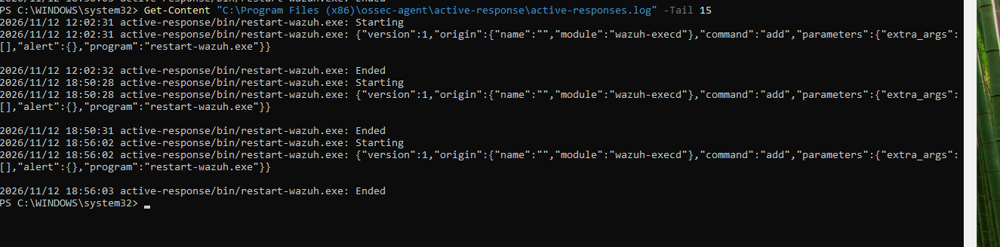
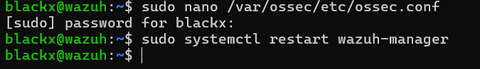
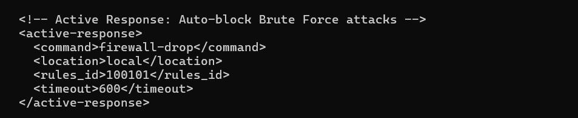
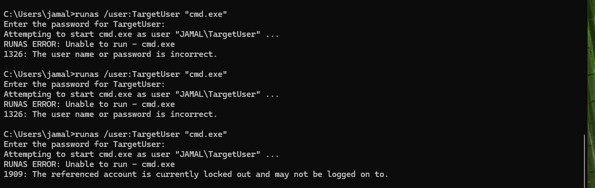

# 🛡️ Project 2: Automated Brute Force Detection & Active Response (Micro-IPS)

## 🎯 Objective
To simulate a credential-based attack (Brute Force) against a Windows endpoint, detect it using custom Wazuh correlation rules, and validate the effectiveness of automated response mechanisms combined with native OS security policies (Defense-in-Depth).

## 🏗️ Architecture
- **SIEM Manager:** Ubuntu 22.04 (Wazuh All-in-One)
- **Target Endpoint:** Windows 11 (Wazuh Agent + Sysmon)
- **Attack Vector:** Local Interactive Brute Force via `runas` command

---

## ⚙️ Implementation & Evidence

### 1. Target Setup
Created a dedicated dummy account (`TargetUser`) to isolate the simulation from production accounts.

### 2. Attack Simulation
Executed 8 rapid failed login attempts using `runas /user:TargetUser "cmd.exe"` with intentionally incorrect passwords, generating Windows Security Event ID 4625 (Failed Logon).

### 3. SIEM Detection (Event Correlation)
Wazuh successfully captured all 6 failed login attempts as individual alerts (Event ID 4625) with:
- **Logon Type:** 2 (Interactive)
- **Failure Reason:** Unknown user name or bad password
- **Sub Status:** 0xC000006A (Wrong password)

### 4. Active Response Configuration
Configured `ossec.conf` to automatically execute the `firewall-drop` command via Wazuh Agent when Rule ID 100101 triggers, with a 10-minute timeout (600 seconds).

### 5. Defense-in-Depth Validation
During the simulation, Windows native **Account Lockout Policy** triggered before the SIEM Active Response could execute, resulting in Error 1909: *"The referenced account is currently locked out"*. This demonstrates effective Defense-in-Depth where multiple security layers work in tandem.

---

## 💡 Key Takeaways & Business Value
- **Correlation Rules:** Transform individual low-level alerts into high-fidelity, actionable incidents (Level 10).
- **Active Response:** Enables automated containment (IPS-like behavior) without human intervention.
- **Defense-in-Depth:** Native OS policies (Account Lockout) act as a safety net when SIEM response experiences slight latency.
- **MITRE ATT&CK Mapping:** Custom rules tagged with T1110 (Brute Force) accelerate incident triage.

## 🚀 Next Steps
Enhance the Active Response to include automated email notifications to the SOC team and integration with external threat intelligence (VirusTotal API) for IP reputation checks.
