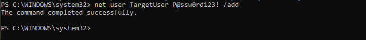
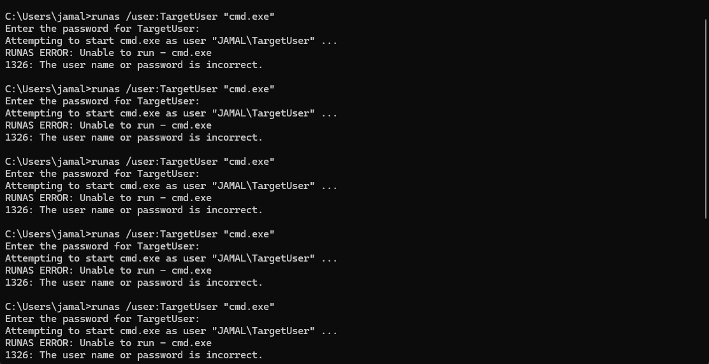
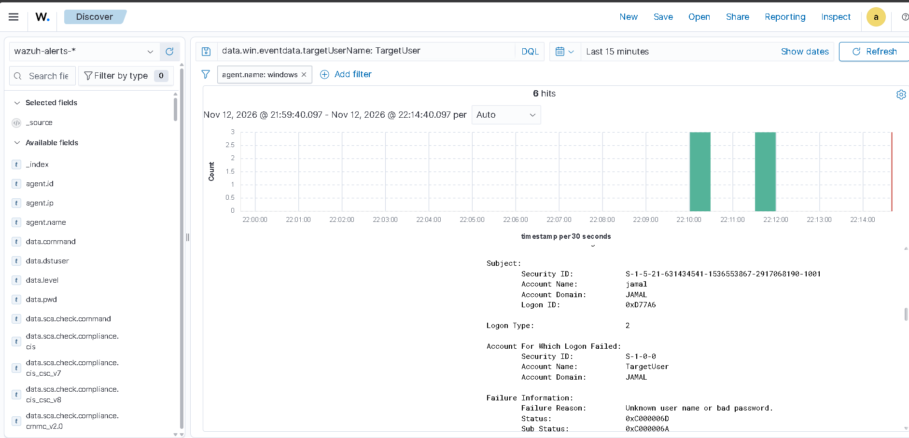
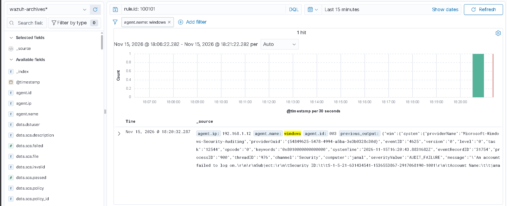
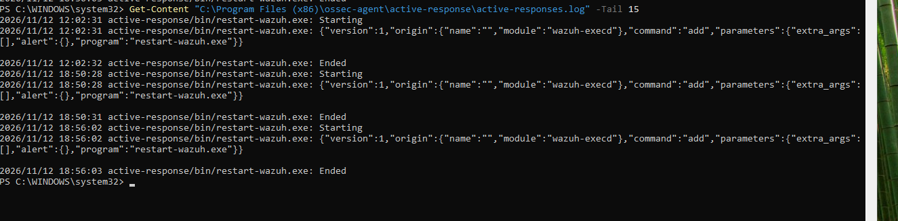
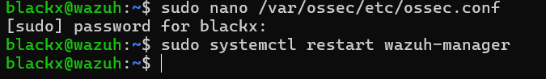
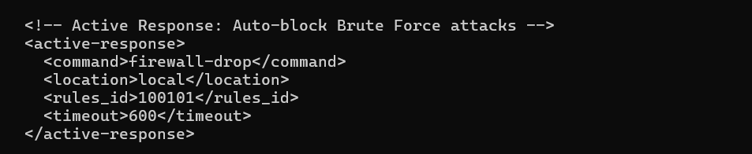
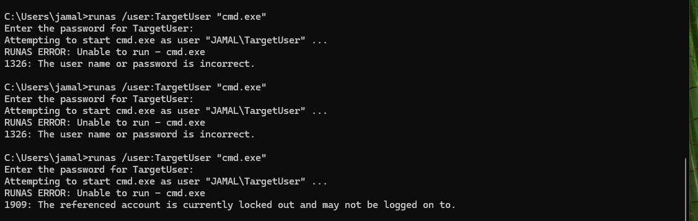

# 🛡️ Project 2: Automated Brute Force Detection & Active Response (Micro-IPS)

## 🎯 Objective
To simulate a credential-based attack (Brute Force) against a Windows endpoint, detect it using custom Wazuh correlation rules, and validate the effectiveness of automated response mechanisms combined with native OS security policies (Defense-in-Depth).

## 🏗️ Architecture
- **SIEM Manager:** Ubuntu 22.04 (Wazuh All-in-One)
- **Target Endpoint:** Windows 11 (Wazuh Agent + Sysmon)
- **Attack Vector:** Local Interactive Brute Force via `runas` command

---

## ⚙️ Implementation & Evidence

### 1. Target Setup
Created a dedicated dummy account (`TargetUser`) to isolate the simulation from production accounts.



### 2. Attack Simulation
Executed rapid failed login attempts using `runas /user:TargetUser "cmd.exe"` with intentionally incorrect passwords, generating Windows Security Event ID 4625 (Failed Logon).



### 3. SIEM Detection (Individual Alerts)
Wazuh successfully captured failed login attempts as individual alerts (Event ID 4625) with:
- **Logon Type:** 2 (Interactive)
- **Failure Reason:** Unknown user name or bad password
- **Sub Status:** 0xC000006A (Wrong password)



### 4. Custom Correlation Rule (Rule ID: 100101)
Authored a custom rule in `local_rules.xml` that triggers a **Level 10 alert** when 3 failed logins occur within 60 seconds (tuned to align with Windows Account Lockout Policy):

```xml
<rule id="100101" level="10" frequency="3" timeframe="60">
  <if_matched_sid>60122</if_matched_sid>
  <description>Brute Force Detected: 3 failed logins in 60 seconds</description>
  <group>authentication_failures,brute_force,</group>
  <mitre>
    <id>T1110</id>
  </mitre>
</rule>
```

### 5. Correlation Rule Triggered (Level 10 Alert) ✅
The correlation rule successfully triggered a **Level 10 critical alert** with proper MITRE ATT&CK mapping:



**Key Evidence:**
- `rule.id: 100101`
- `rule.level: 10`
- `rule.frequency: 3`
- `rule.mitre.technique: Brute Force`
- `previous_output`: Shows the preceding failed login events that were correlated

### 6. Active Response Configuration
Configured `ossec.conf` to automatically execute the `firewall-drop` command via Wazuh Agent when Rule ID 100101 triggers, with a 10-minute timeout (600 seconds).







### 7. Defense-in-Depth Validation
During the simulation, Windows native **Account Lockout Policy** triggered before the SIEM Active Response could execute, resulting in Error 1909: *"The referenced account is currently locked out"*. This demonstrates effective Defense-in-Depth where multiple security layers work in tandem.



---

## 💡 Key Takeaways & Business Value
- **Correlation Rules:** Transform individual low-level alerts into high-fidelity, actionable incidents (Level 10).
- **Active Response:** Enables automated containment (IPS-like behavior) without human intervention.
- **Defense-in-Depth:** Native OS policies (Account Lockout) act as a safety net when SIEM response experiences slight latency.
- **MITRE ATT&CK Mapping:** Custom rules tagged with T1110 (Brute Force) accelerate incident triage.
- **Troubleshooting:** Diagnosed and resolved XML parsing errors and rule tuning issues during deployment.

## 🔗 Related Project
- [Project 1: Enterprise-Grade SIEM Tuning](https://github.com/jamal-soc21/SOC-Lab-Project-1-Wazuh-Sysmon-Tuning)

## 🚀 Next Steps
- Implement automated email/Slack notifications to the SOC team.
- Integrate external threat intelligence (VirusTotal API) for IP reputation checks.
- Extend detection to SSH Brute Force on Linux endpoints.

---

**Author:** Jamal | SOC Analyst Trainee | Tier 1 → Tier 2 Pipeline
